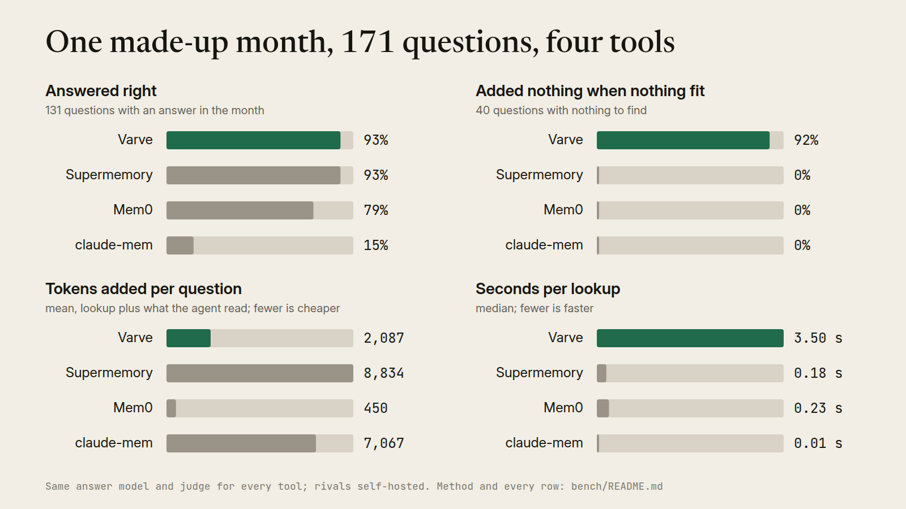

# Benchmarks

These benchmarks ask one question: when an agent gets a new message, does the knowledge base's check hand it what it needs, and stay quiet when nothing fits? Every number here comes from a results file with one row per question, and every run can be repeated from this folder.

The product's name lives in `bench/product.py`. This README calls it "the check", after the step it measures, and `kb`, its command.

## Rerun the month

The made-up month is `demo/month/` (see its README). One command loads it into each tool's fresh store, puts the 171 questions through the tool, has one answer model answer and one judge grade, and prints the table:

```bash
python3 bench/run.py month --tools none,oracle,check,check-cards
python3 bench/run.py table            # print the table from the saved rows
python3 bench/run.py rejudge --why "REASON"            # grade saved answers again, after a gold or judge change
python3 bench/run.py rejudge --why "REASON" --only ID,ID   # just those questions; every other verdict stays
python3 bench/run.py rejudge --why "REASON" --second bench/results/month/second-grading.jsonl   # keep both verdicts
```

Rows go to `bench/results/month/<tool>.jsonl`, and the table to `bench/results/month/table.md`. `second-grading.jsonl` holds a second grading of the same answers, both verdicts per row, which measures how often the judge agrees with itself. A rerun keeps the rows already written and runs only the missing questions; pass `--fresh` to start over. The first rate limit (HTTP 429, or a reply that says the model is cooling down) is never retried: the run starts no new question, keeps every row it has, and the same command run once 30 minutes later fills in the rest. The same holds for `rejudge` (resumed by its `--why`), `latency` and `bench/lookups.py`. Mem0's load stops the same way, and its OpenAI client no longer retries a rate limit by itself; the rerun loads it again from the start, since its store lives in a temporary folder. Supermemory and claude-mem call their model from their own servers, which the harness cannot stop: load each one alone, and watch its server's log.

Model calls go to any endpoint that speaks Anthropic's Messages API: `BENCH_BASE_URL` (default `http://127.0.0.1:8317`, a local CLIProxyAPI gateway) and `BENCH_API_KEY`. The judge model is a GPT model served through that gateway; with a plain Anthropic key, change `JUDGE_MODEL` in `run.py`.

The check runs from this repo's package: `kb/check.py`, `kb/search.py` and `kb/summarize.py`, with the package's Anthropic-compatible plug-in pointed at `BENCH_BASE_URL`. The agent's `kb search` and `kb get` are the package's own commands, run against each scratch store. Each run records the package code's hash and the commit. The published rows below ran from a copy of kb's code at 4a884a2, before the package landed; rerun from the package, the month matches them (see "Dev and test halves").

The rival tools need their own setup, all local, with no account:

| Tool | What to start first |
|---|---|
| `mem0` | A Python with `pip install "mem0ai[nlp,extras]==2.2.1" sentence-transformers` and the spaCy model `en_core_web_sm`. Run `run.py` with that Python. |
| `supermemory` | `docker run -d --name sm-bench --network host -e OPENAI_API_KEY=<gateway key> -e OPENAI_BASE_URL=http://127.0.0.1:8317/v1 -e OPENAI_MODEL=claude-haiku-5-5 -e SUPERMEMORY_DISABLE_TELEMETRY=1 -v <dir>:/data supermemory/supermemory:0.0.9`, then `SUPERMEMORY_KEY_FILE=<dir>/api-key`. |
| `claude-mem` | `HOME=<scratch> npx claude-mem@15.3.0 install --provider claude --no-auto-start`; in `<scratch>/.claude-mem/settings.json` set `CLAUDE_MEM_CLAUDE_AUTH_METHOD` to `gateway` and `CLAUDE_MEM_MODEL` to `claude-haiku-5-5`; put `ANTHROPIC_BASE_URL` and `ANTHROPIC_AUTH_TOKEN` in `<scratch>/.claude-mem/.env`; run `HOME=<scratch> claude-mem start`, then set `CLAUDE_MEM_HOME=<scratch>` for the run; the adapter and claude-mem's MCP server both read the worker's address from the settings there. |

`python3 bench/run.py latency --tools check,supermemory,claude-mem` times lookups alone, one at a time and alternating between tools, into `bench/results/month/latency.jsonl`.

## How a question runs

1. The tool loads `demo/month/items.jsonl` into a fresh store. The check stores the items with the package's code and writes its summaries for long items, as ingest does, for each source its type summarizes by default.
2. The question arrives as a new message to an agent, with no conversation before it. The tool's lookup returns the text an agent would see before the message, or nothing.
3. The answer model (`claude-sonnet-5-5`) answers from that text. It is told it works for the month's persona and that today is October 1, 2026. When the product gives agents commands to read more, the answer model gets them as tools: `kb search` and `kb get` for the check (its own header tells agents to run them), `search_memory` for Mem0 (OpenMemory MCP's name), a search for Supermemory, and claude-mem's three MCP search tools (`search`, `timeline`, `get_observations`), served by claude-mem's own MCP server with its own schemas and replies. It gets at most 8 tool turns.
4. The judge (`gpt-6.1-sol`, a different model family from the answer model and from the check's own `claude-haiku-5-5`) compares the answer with the gold answer and returns correct or not, with a reason.

The check's own two model calls, and the summaries at ingest, run on `claude-haiku-5-5`, as they do in kb. The check's model tokens count the gateway's cached input too: the gateway caches every prompt, and its `input_tokens` leaves the cached part out.

## What each column means

| Column | Meaning |
|---|---|
| accuracy | Questions the judge graded correct, of all 171. |
| answerable | The same, for the 131 questions that have an answer in the month. |
| nothing fits | The same, for the 40 questions where nothing in the month fits. Correct means the agent said it didn't know, or answered a general question correctly, without inventing facts. |
| added nothing when nothing fits | Of those 40, how often the tool's lookup returned nothing at all. |
| evidence reached | Of the answerable questions, how often an item that holds the answer reached the agent, by the lookup or the agent's own tool calls. Only tools that report which items they returned have it. |
| tokens added per question | Tokens of lookup text plus tool output that entered the agent's context, counted with the answer model's tokenizer. |
| lookup p50 / p90 s | Seconds the lookup took, per question. |

## How each rival ran

Each rival ran its documented recommended setup, with two changes every self-hosted run needs here: its model is `claude-haiku-5-5` through the gateway, the same small model the check uses, because the defaults need an OpenAI key; and embeddings, where needed, are local.

| Tool | Version | Setup | What differs from its defaults |
|---|---|---|---|
| Mem0 | mem0ai 2.2.1, open source | Each month item added as one user message, oldest first. Lookup is the README's: `search(top_k=3)`, listed under "User Memories:". | LLM `claude-haiku-5-5` (default `gpt-5-mini`); embedder `BAAI/bge-base-en-v1.5` (default `text-embedding-3-small`); `nlp` and `extras` installed so its entity and BM25 search run. Mem0 says its published scores come from its platform, which has optimizations the open-source library lacks. |
| Supermemory | server 0.0.9 (docker), "lite" | Each item posted as one document, default processing; the run waited until all 471 had their memories. Lookup is the quickstart's chat harness: the profile, 5 memories and 3 document chunks. | `OPENAI_MODEL=claude-haiku-5-5` (default `gpt-5.1`); telemetry off. Supermemory says its hosted platform uses its own models for extraction. |
| claude-mem | 15.3.0 | Only agent sessions: the 81 Claude Code, Codex and Hermes items, replayed one at a time through the worker routes its hooks call (each prompt, each tool call with its output, the closing summary). Lookup is its session-start context for a folder outside any repo; per-prompt lookup is off by default, and a second row turns it on. | `CLAUDE_MEM_MODEL=claude-haiku-5-5` (default `claude-haiku-4-5`); telemetry off. Observations carry the replay's time, not the month's dates. |

Load notes from `run.json` and the run logs:

- Mem0 made 1,150 memories from 471 adds in 45 minutes. 22 adds stored nothing, because the model's fact-extraction JSON did not parse. Mem0's telemetry was on for this run, its default; the adapter now turns it off.
- Supermemory finished extracting memories from all 471 documents about two hours after they were posted, at about 3.5 documents a minute. A first run that posted them was stopped by a time limit; the second run reused the posted documents and waited for the rest.
- claude-mem took 142 minutes to compress the 81 sessions into 504 observations and 54 summaries. Replayed all at once, sessions park behind its two agent slots and never finish, so the replay waits for each session.
- claude-mem's agent tools are its own MCP server's, started the way its plugin registers it, so the agent sees the vendor's tool schemas and formatted replies. The rows in this folder come from that setup, against the same store.

## Dev and test halves

Changes to the check are tuned on dev halves and reported on test halves that tuning never reads. `bench/splits.py` fixes them, and `bench/splits/` holds the ids:

| Test | Dev | Test |
|---|---|---|
| The made-up month | month A, `demo/month` | month B, `bench/month-b`: its own stories and questions, written apart from any tuning, on month A's background items |
| LongMemEval S | 250 questions | 250 questions: by question id hash within each question type, abstention questions apart |
| LoCoMo | conversations 1 to 5 | conversations 6 to 10 |

A seed alone cannot make a held-out month: it changes only ids and the seconds of each time, so month B has its own stories (`bench/month/stories_b/`).

```bash
bench/dev.sh LABEL [--slice]                        # one pass over the three dev halves; --slice: 100 and 150 questions
python3 bench/compare.py LABEL --noise noise1,noise2,noise3   # dev numbers beside the baseline's repeat runs
python3 bench/lookups.py LABEL                      # the check's lookups alone: a screen with no answer model or judge
python3 bench/run.py month --month b --label baseline --tools check   # a held-out run
python3 bench/public/longmemeval.py --set s --split test --label baseline
python3 bench/public/locomo.py --split test --label baseline
```

A test half runs at most three times, once each as `baseline`, `midpoint` and `final`, and `bench/splits/heldout-runs.tsv` logs every run. "Handled right" on the month counts a correct answer, and for a question nothing fits, a lookup that also added nothing. Tokens per question count the cards, the agent's `kb` commands and the check's own model calls.

## Results on the made-up month



All rows are in `bench/results/month/`, and `table.md` there has the full table. Graded once, then graded a second time with the same rubric, the rows agree on 1,360 of 1,368; `second-grading.jsonl` holds both verdicts for every row. No tool's verdicts flipped on more than 4 of its 171 questions, so a gap of four questions or fewer between two tools is not measurable here. To grade again, copy the per-tool row files to a folder and run `python3 bench/run.py rejudge <folder> --why "REASON"`. Four gold answers were completed after audits on 2026-10-27 (`demo/month/README.md`); the rows were graded again for those questions, and `bench/results/regrades.tsv` holds before and after.

| Tool | Right, of 131 with an answer | Added nothing, of 40 with nothing to find | Tokens added per question, mean | Lookup, median |
|---|---|---|---|---|
| The check, with `kb search` and `kb get` | 122 | 37 | 2,087 | 3.52 s |
| The check, cards only | 57 | 37 | 288 | 3.63 s |
| Supermemory, self-hosted | 121 | 0 | 8,834 | 0.18 s |
| Mem0, open source | 102 | 0 | 450 | 0.23 s |
| claude-mem | 19 | 0 | 7,067 | 0.01 s |
| claude-mem, per-prompt lookup on | 19 | 0 | 6,418 | 0.23 s |
| Gold records | 126 | 40 | 550 | |
| No lookup | 1 | 40 | 0 | |

Every tool's agent said it didn't know, or answered correctly, on 39 or 40 of the 40 questions where nothing fits. The difference is what each tool put in front of the agent first.

What limits each number:

- **The check and Supermemory.** The check answers 122 and misses 9; Supermemory answers 121 and misses 10. For Supermemory, items from the right documents reached the agent in all 10 misses. For the check they reached it in 6, and in 3 neither the lookup nor the agent's own searches found them. The two differ elsewhere. Supermemory's documented harness puts its whole profile, 5 memories and 3 document chunks before every message, about 6,800 tokens at the median, so it never adds nothing. The check adds a median of 266 tokens of cards and adds nothing on 37 of the 40 no-fit questions; the agent then reads about 1,200 tokens at the median with `kb get`. The check's lookup is two `claude-haiku-5-5` calls in a row, a query writer and a picker, so it takes 3.5 s where the rivals' lookups make no model call.
- **Cards alone.** A card is a 240-character snippet. In 59 of the 74 misses the right item was among the cards, but the snippet did not hold the answer. With `kb get` the same lookup answers 122.
- **Mem0.** It returns 3 memories for every message. In 23 of its 29 misses, an item that holds the answer was among the memories' sources, but the extracted memory lacked the detail asked for. Its log shows 22 fact-extraction replies that did not parse, and Mem0 stores no memories for those adds.
- **claude-mem.** It records agent sessions only. Only 37 of the 131 questions with an answer have any evidence in an agent session, and it answered 18 of those. Its per-prompt lookup, off by default, answered the same number. Its agent uses claude-mem's own MCP search tools and read about 7,000 tokens per question with them.
- **The gold records.** With the right items handed over, the answer model and judge still miss 5 of 131. That is the ceiling for every tool.
- **Lookup times.** These are the month run's, measured while other runs shared the gateway. Timed alone, 80 lookups each, the check's median is 3.28 s (p90 4.81 s), Supermemory's 0.17 s and claude-mem's 0.01 s (`latency.jsonl`).
- **What this month can't show.** Each question ran once, so run-to-run spread is not measured. The month and its questions were written by the same team as the check. The rivals ran self-hosted on `claude-haiku-5-5`; Mem0 and Supermemory both say their hosted platforms extract memories better. The check ran from kb's code at 4a884a2 with the product's prompt wording, not from the released package.

## Results on LongMemEval and LoCoMo

`bench/results/public/README.md` has the commands, every table and what limits each number, and `bench/public/DEVIATIONS.md` lists every difference from the published setups. Answer model `claude-sonnet-5-5`, judge `gpt-6.1-sol` with each test's own prompts, each question once.

| Test | Questions | The check |
|---|---|---|
| LongMemEval S, without summaries | 500 | 92.6% |
| LongMemEval oracle, with summaries | 500 | 94.8% |
| LoCoMo, categories 1 to 4 | 1,540 | 90.4% LLM judge, 65.8 token F1 |

Published numbers from others, from `bench/public/rivals.json`. None used the same answer model or judge as this run, so they sit beside these numbers and are not a ranking.

| System | LongMemEval | LoCoMo | Models | Label |
|---|---|---|---|---|
| Mem0 platform, 2026 | 94.4% (S) | 92.5% | gpt-5 answers and judges; Mem0's own judge prompt | vendor |
| Supermemory | 85.2% (S) | none published | gemini-3-pro answers, gpt-4o judges | vendor |
| Supermemory, rerun by Maximem | 71.3% | | gpt-5 | a rival vendor |
| Zep, 2026 | 90.2% | 94.7% | gpt-5.4 answers and judges | vendor |
| Letta filesystem agent | none published | 74.0% | gpt-4o-mini | vendor |
| Full context, no memory layer | 60.6% (S), 87.0% (oracle) | 72.9% | gpt-4o; gpt-4o-mini | the benchmark's authors; Mem0 |

## Results on a real history

The check also ran on its owner's real knowledge base: 53 questions written from raw records, run read-only, with only Claude models (`claude-sonnet-5-5` answers, `claude-opus-5-5` judges). The questions, rows and answers stay private; these are the only numbers that leave it.

| | Right, of 53 | Of 42 with an answer | Of 11 with nothing to find |
|---|---|---|---|
| The check, as it runs today | 51 | 40 | 11 |
| No lookup | 11 | 0 | 11 |

The questions were found with `kb search`, so every answerable one is reachable by keyword search, which favours the check. With 42 answerable questions, one question moves the score by 2.4 points. The sessions that wrote the questions were hidden from every search. On 8 of the 11 questions with nothing to find, the check added nothing.
